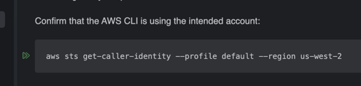

# S3 CSV Batch Processor

Terraform deploys two S3 buckets and three Java 25 Lambda functions:

1. Uploading a `.csv` file to the source bucket invokes the dispatcher.
2. The dispatcher counts physical data lines after the header and asynchronously invokes the processor once per 10,000 lines.
3. Each processor converts its assigned lines to a JSON array and stores the result in the destination bucket.
4. A loader Lambda reads each generated JSON batch and inserts its records into Aurora MySQL.
5. After the final successful load, the query Lambda emails an aggregate CSV report through SES.

## Prerequisites

- Java 25 and Maven 3.9+
- Terraform 1.5+
- AWS credentials configured for the selected region
- SES Identity (Both Sender and Receiver)

## Deploy & Test
Check AWS_RUNBOOK.md, Please use IntelliJ as it has a feature to render and execute code block so you won't have a hard time copying commands.

You can just click on green double arrow button

### SES prerequisites

Before deploying the query email flow:

- Verify `SES_FROM_EMAIL` or its domain in the same AWS Region used by the query Lambda.
- If the SES account is still in the sandbox, verify `SES_TO_EMAIL` too, or request production access to send to unverified recipients.
- Confirm the query Lambda role has `ses:SendRawEmail`.
- Confirm that the SES interface endpoint is available before sending mail. Terraform creates the `com.amazonaws.<region>.email` interface endpoint for the query Lambda.