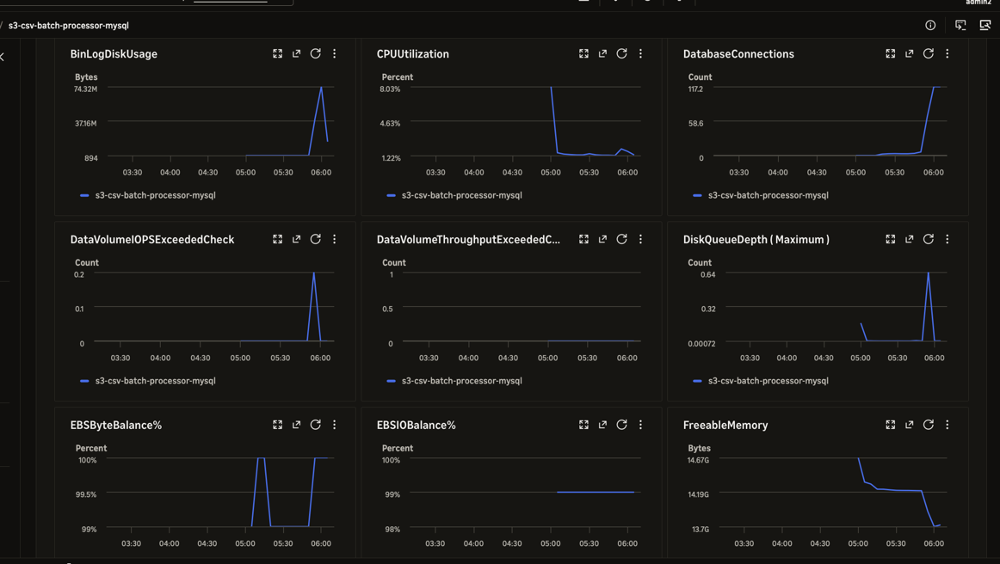
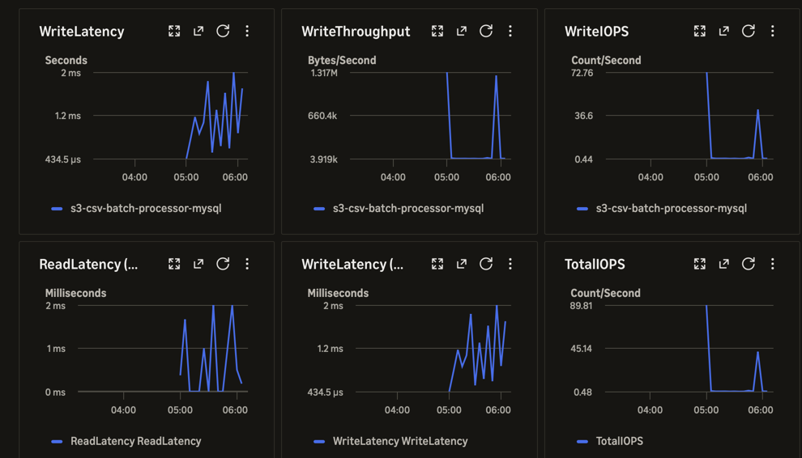

| function\_name | configured\_memory\_mb | count\(function\_name\) | min\(runtime\) | avg\(runtime\) | max\(runtime\) |
| :--- | ---: | ---: | ---: | ---: | ---: |
| s3-csv-batch-processor-dispatcher | 1769 | 2 | 5815 | 6181.5000 | 6548 |
| s3-csv-batch-processor-loader | 640 | 100 | 701 | 1414.8800 | 3731 |
| s3-csv-batch-processor-processor | 640 | 1 | 38325 | 38325.0000 | 38325 |
| s3-csv-batch-processor-query | 1024 | 1 | 1762 | 1762.0000 | 1762 |

##### Total Pipeline Execution Time: 54104ms 

### Estimated Lambda Cost (USD)

Using x86 on-demand rates in `us-east-2` ([AWS Lambda pricing](https://aws.amazon.com/lambda/pricing/)): $0.0000166667 per GB-second and $0.20 per million requests. Compute uses recorded SAAF runtime and configured memory; amounts are before free tier, discounts, and credits.

| compute | requests | total |
| ---: | ---: | ---: |
| $0.00225838 | $0.00002080 | $0.00227918 |

### S3 Event and Loader Latency

| min\(s3\_latency\_ms\) | avg\(s3\_latency\_ms\) | max\(s3\_latency\_ms\) |
| :--- | :--- | :--- |
| 463 | 1552.1100 | 4927 |

### RDS Metrics

