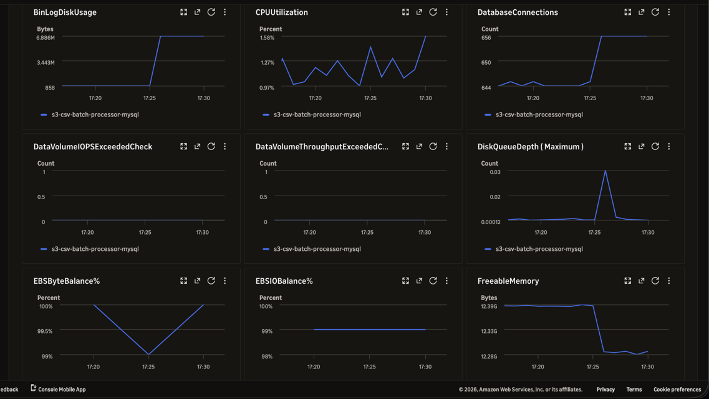
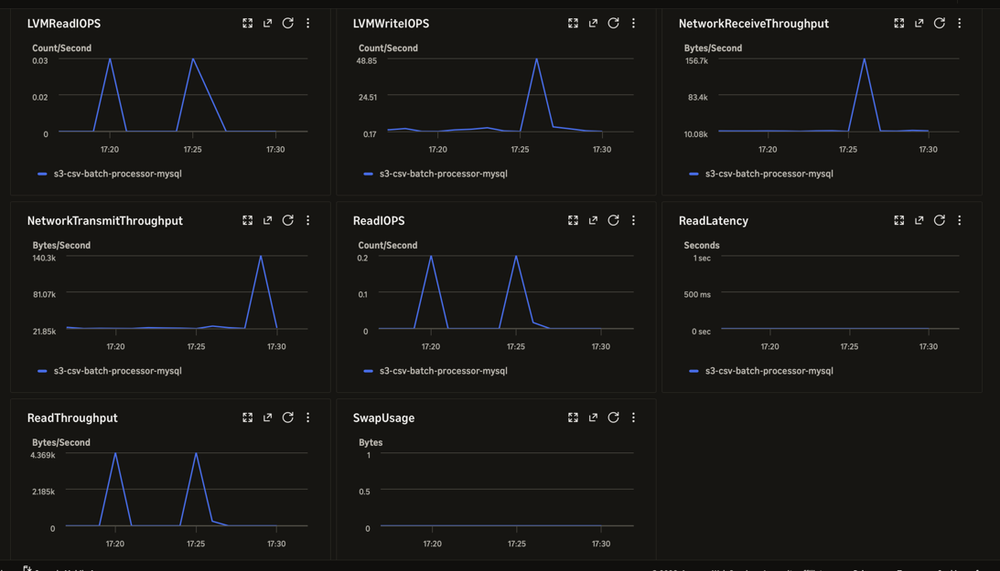
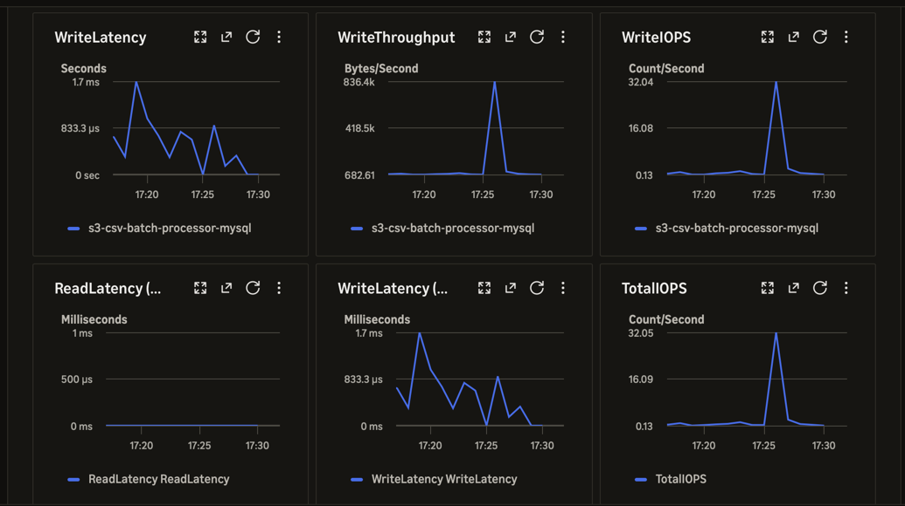

| function\_name | configured\_memory\_mb | count\(function\_name\) | min\(runtime\) | avg\(runtime\) | max\(runtime\) |
| :--- | ---: | ---: | ---: | ---: | ---: |
| s3-csv-batch-processor-dispatcher | 1769 | 1 | 1986 | 1986.0000 | 1986 |
| s3-csv-batch-processor-loader | 640 | 10 | 3176 | 3284.3000 | 3492 |
| s3-csv-batch-processor-processor | 640 | 1 | 4919 | 4919.0000 | 4919 |
| s3-csv-batch-processor-query | 1024 | 1 | 1308 | 1308.0000 | 1308 |

##### Total Pipeline Execution Time: 21767ms

### Estimated Lambda Cost (USD)

Using x86 on-demand rates in `us-east-2` ([AWS Lambda pricing](https://aws.amazon.com/lambda/pricing/)): $0.0000166667 per GB-second and $0.20 per million requests. Compute uses recorded SAAF runtime and configured memory; amounts are before free tier, discounts, and credits.

| compute | requests | total |
| ---: | ---: | ---: |
| $0.00047234 | $0.00000260 | $0.00047494 |

### S3 Event and Loader Latency

| min\(s3\_latency\_ms\) | avg\(s3\_latency\_ms\) | max\(s3\_latency\_ms\) |
| :--- | :--- | :--- |
| 3684 | 4091.3000 | 4736 |

### RDS Metrics

