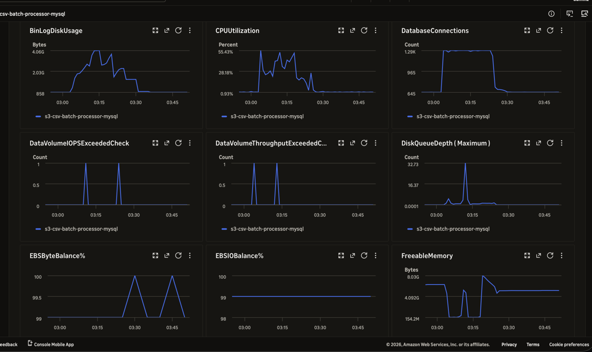
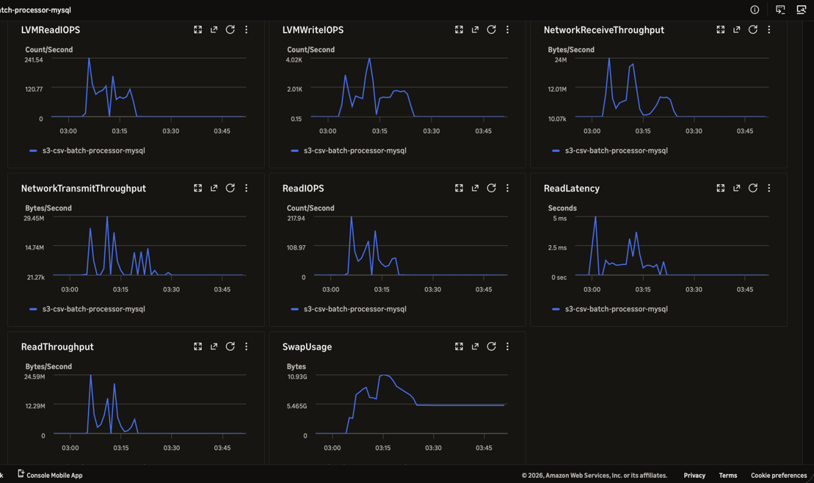
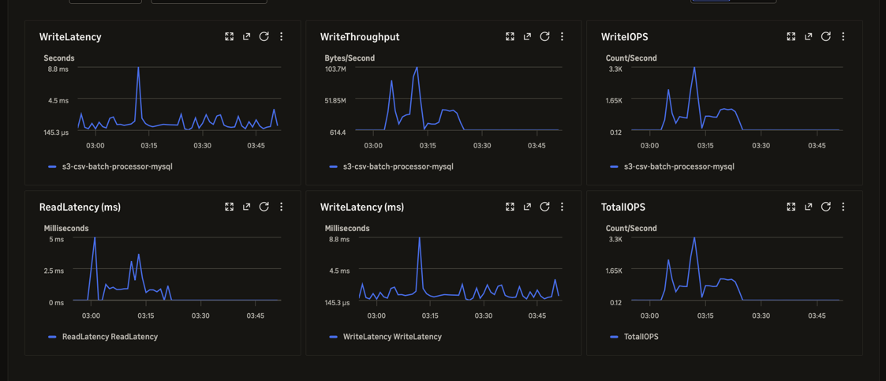

| function\_name | configured\_memory\_mb | count\(function\_name\) | min\(runtime\) | avg\(runtime\) | max\(runtime\) |
| :--- | :--- | :--- | :--- | :--- | :--- |
| s3-csv-batch-processor-dispatcher | 1769 | 1 | 466320 | 466320.0000 | 466320 |
| s3-csv-batch-processor-loader | 640 | 10818 | 639 | 28700.3221 | 299007 |
| s3-csv-batch-processor-processor | 640 | 109 | 6623 | 36433.8716 | 39621 |
| s3-csv-batch-processor-query | 1024 | 1 | 122727 | 122727.0000 | 122727 |

##### Total Pipeline Execution Time: 1796229ms

### Estimated Lambda Cost (USD)

Using x86 on-demand rates in `us-east-2` ([AWS Lambda pricing](https://aws.amazon.com/lambda/pricing/)): $0.0000166667 per GB-second and $0.20 per million requests. Compute uses recorded SAAF runtime and configured memory; amounts are before free tier, discounts, and credits.

| compute | requests | total |
| ---: | ---: | ---: |
| $3.29101364 | $0.00218580 | $3.29319944 |

### S3 Event and Loader Latency

| min\(s3\_latency\_ms\) | avg\(s3\_latency\_ms\) | max\(s3\_latency\_ms\) |
| :--- | :--- | :--- |
| 359 | 459309.5361 | 1209114 |

### RDS Metrics

