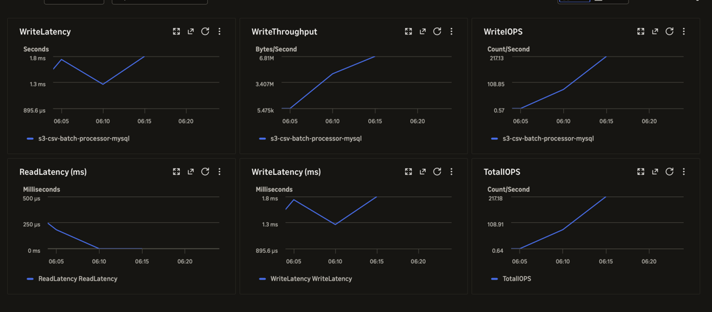

| function\_name | count\(function\_name\) | min\(runtime\) | avg\(runtime\) | max\(runtime\) |
| :--- | :--- | :--- | :--- | :--- |
| s3-csv-batch-processor-dispatcher | 1 | 44058 | 44058.0000 | 44058 |
| s3-csv-batch-processor-loader | 1000 | 673 | 4265.3770 | 9033 |
| s3-csv-batch-processor-processor | 10 | 34884 | 36439.3000 | 37937 |
| s3-csv-batch-processor-query | 1 | 5545 | 5545.0000 | 5545 |

### S3 Event and Loader Latency

| min\(s3\_latency\_ms\) | avg\(s3\_latency\_ms\) | max\(s3\_latency\_ms\) |
| :--- | :--- | :--- |
| 385 | 1594.9200 | 4777 |

### RDS Metrics

