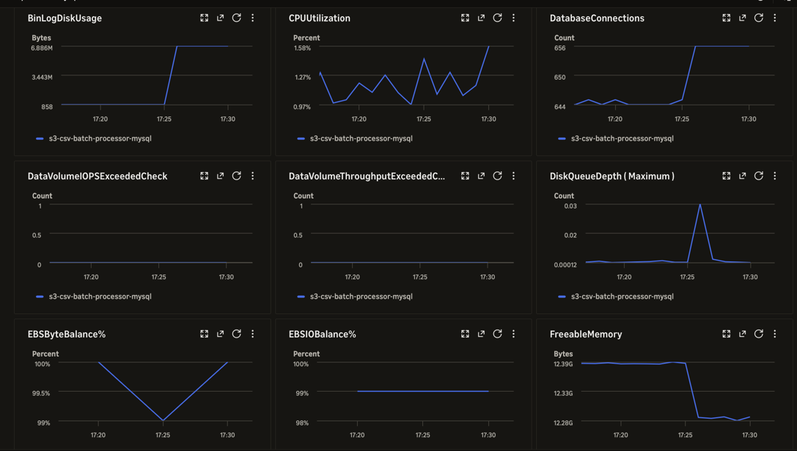
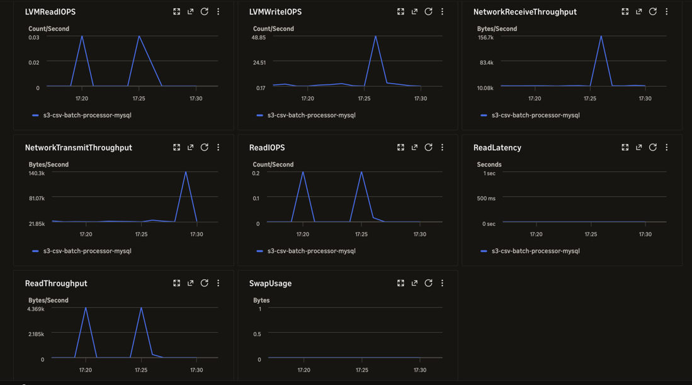
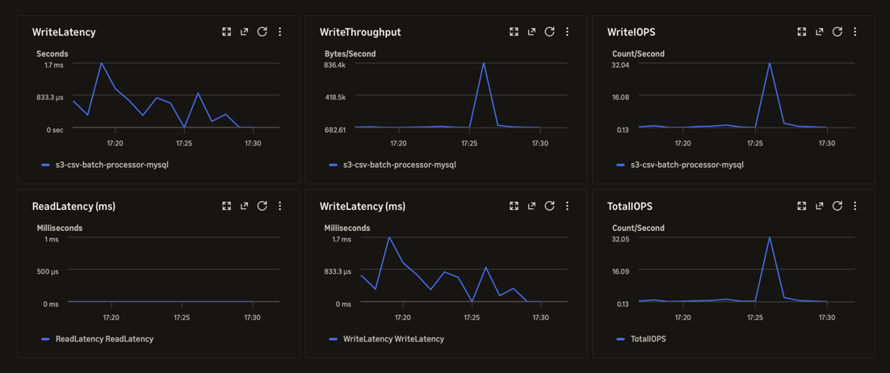

| function\_name | configured\_memory\_mb | count\(function\_name\) | min\(runtime\) | avg\(runtime\) | max\(runtime\) |
| :--- | ---: | ---: | ---: | ---: | ---: |
| s3-csv-batch-processor-dispatcher | 1769 | 1 | 64748 | 64748.0000 | 64748 |
| s3-csv-batch-processor-loader | 640 | 3000 | 670 | 9413.3380 | 22918 |
| s3-csv-batch-processor-processor | 640 | 30 | 29634 | 36360.7333 | 39297 |
| s3-csv-batch-processor-query | 1024 | 1 | 14089 | 14089.0000 | 14089 |

##### Total Pipeline Execution Time: 228001ms

### Estimated Lambda Cost (USD)

Using x86 on-demand rates in `us-east-2` ([AWS Lambda pricing](https://aws.amazon.com/lambda/pricing/)): $0.0000166667 per GB-second and $0.20 per million requests. Compute uses recorded SAAF runtime and configured memory; amounts are before free tier, discounts, and credits.

| compute | requests | total |
| ---: | ---: | ---: |
| $0.30762922 | $0.00060640 | $0.30823562 |

### S3 Event and Loader Latency

| min\(s3\_latency\_ms\) | avg\(s3\_latency\_ms\) | max\(s3\_latency\_ms\) |
| :--- | :--- | :--- |
| 285 | 28311.1630 | 136073 |

### RDS Metrics

