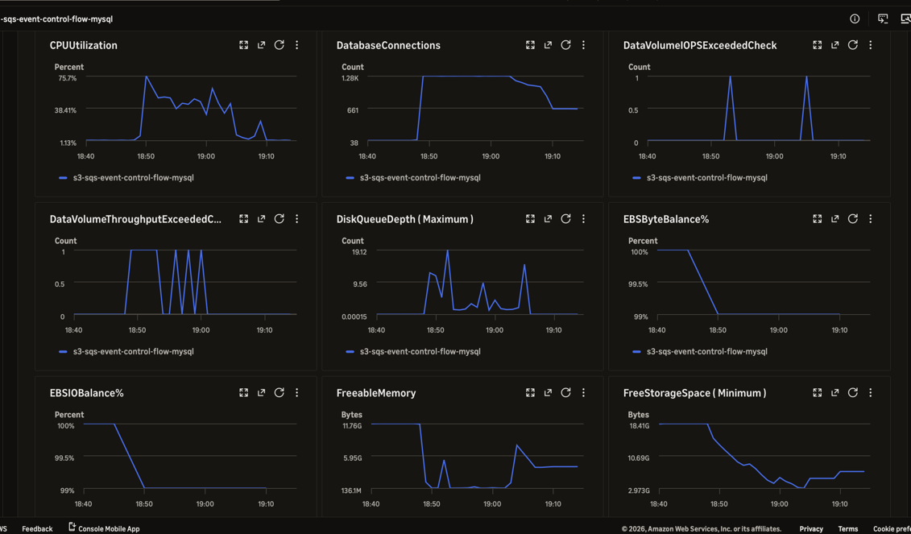
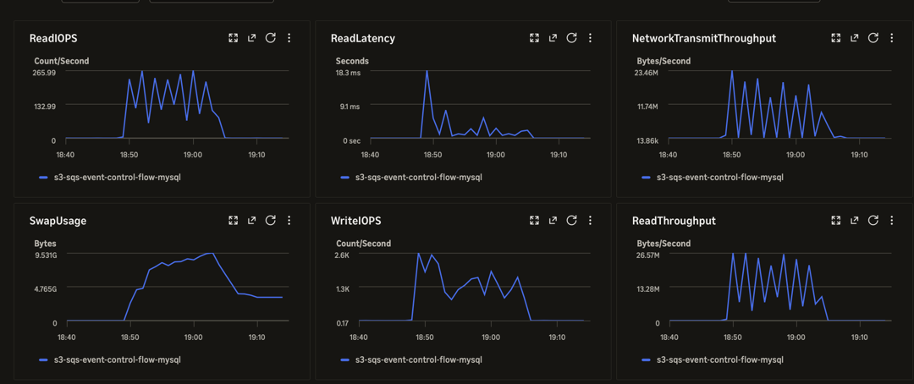
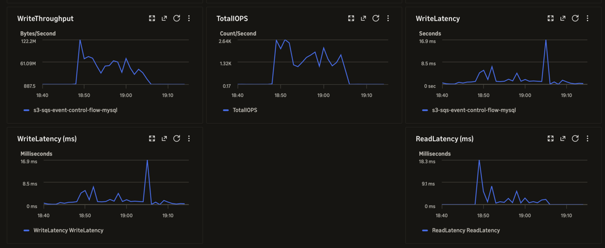

| function\_name | configured\_memory\_mb | count\(function\_name\) | min\(runtime\) | avg\(runtime\) | max\(runtime\) |
| :--- | :--- | :--- | :--- | :--- | :--- |
| s3-sqs-event-control-flow-dispatcher | 1769 | 1 | 462764 | 462764.0000 | 462764 |
| s3-sqs-event-control-flow-loader | 640 | 10818 | 705 | 30638.1309 | 147914 |
| s3-sqs-event-control-flow-processor | 640 | 109 | 9571 | 47785.6697 | 52042 |
| s3-sqs-event-control-flow-query | 1024 | 1 | 286526 | 286526.0000 | 286526 |

`configured_memory_mb` reflects current Terraform allocations, not measured peak memory or necessarily the allocation used when this run was captured.

##### Total pipeline execution time: 1673212ms

### Estimated Lambda cost (USD)

Estimate uses current configured memory, SAAF average runtime, x86\_64 in us-east-2, and on-demand rates of $0.0000166667 per GB-second plus $0.20 per million requests. It excludes free tier, discounts, and non-Lambda charges such as SQS, S3, RDS, and CloudWatch Logs.

| compute cost | request cost | total Lambda cost |
| ---: | ---: | ---: |
| $3.52489755 | $0.00218580 | $3.52708335 |

### SQS latency (ms)

| min\(sqs\_latency\_ms\) | avg\(sqs\_latency\_ms\) | max\(sqs\_latency\_ms\) |
| :--- | :--- | :--- |
| 478 | 338424.9012 | 850721 |

### Database Metrics

