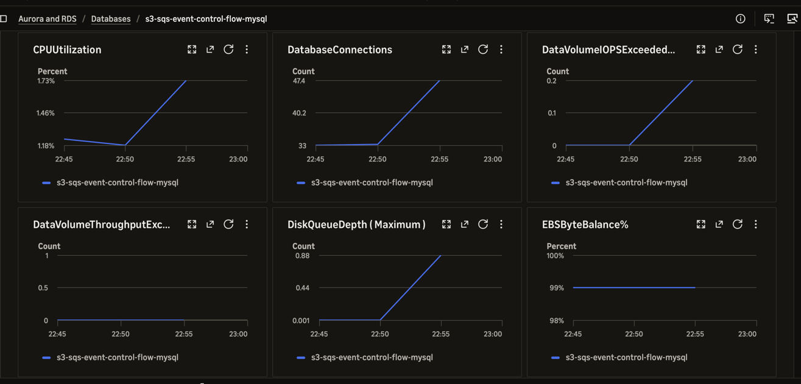
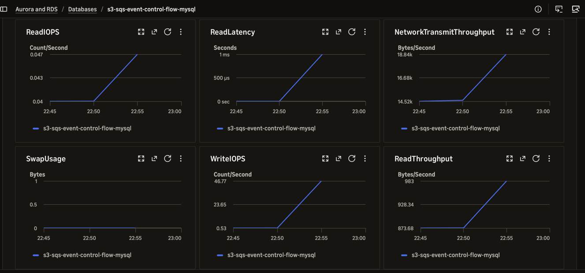
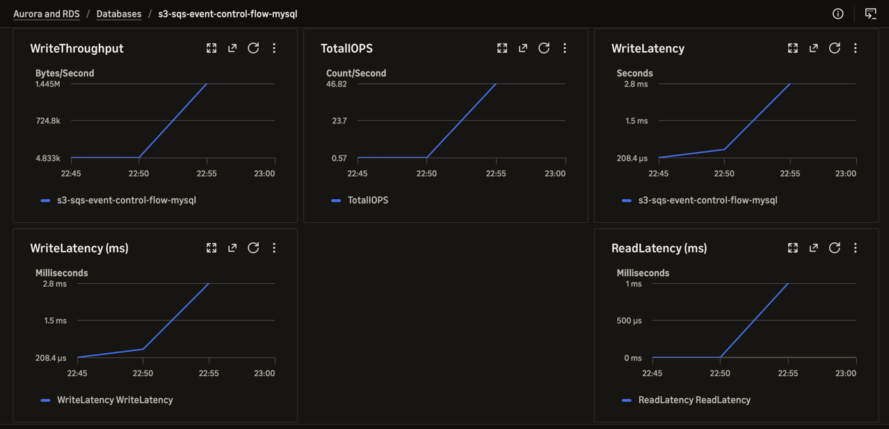

| function\_name | configured\_memory\_mb | count\(function\_name\) | min\(runtime\) | avg\(runtime\) | max\(runtime\) |
| :--- | ---: | ---: | ---: | ---: | ---: |
| s3-sqs-event-control-flow-dispatcher | 1769 | 1 | 43722 | 43722.0000 | 43722 |
| s3-sqs-event-control-flow-loader | 640 | 1000 | 593 | 1223.4520 | 3539 |
| s3-sqs-event-control-flow-processor | 640 | 10 | 45442 | 48373.4000 | 51341 |
| s3-sqs-event-control-flow-query | 1024 | 1 | 5540 | 5540.0000 | 5540 |

`configured_memory_mb` reflects current Terraform allocations, not measured peak memory or necessarily the allocation used when this run was captured.

##### Total pipeline execution time: 107184ms

### Estimated Lambda cost (USD)

Estimate uses current configured memory, SAAF average runtime, x86\_64 in us-east-2, and on-demand rates of $0.0000166667 per GB-second plus $0.20 per million requests. It excludes free tier, discounts, and non-Lambda charges such as SQS, S3, RDS, and CloudWatch Logs.

| compute cost | request cost | total Lambda cost |
| ---: | ---: | ---: |
| $0.01913442 | $0.00020240 | $0.01933682 |

### SQS latency (ms)

| min\(sqs\_latency\_ms\) | avg\(sqs\_latency\_ms\) | max\(sqs\_latency\_ms\) |
| :--- | :--- | :--- |
| 208 | 2762.8510 | 12342 |

### RDS Metrics

