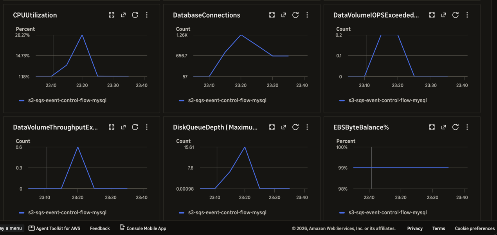
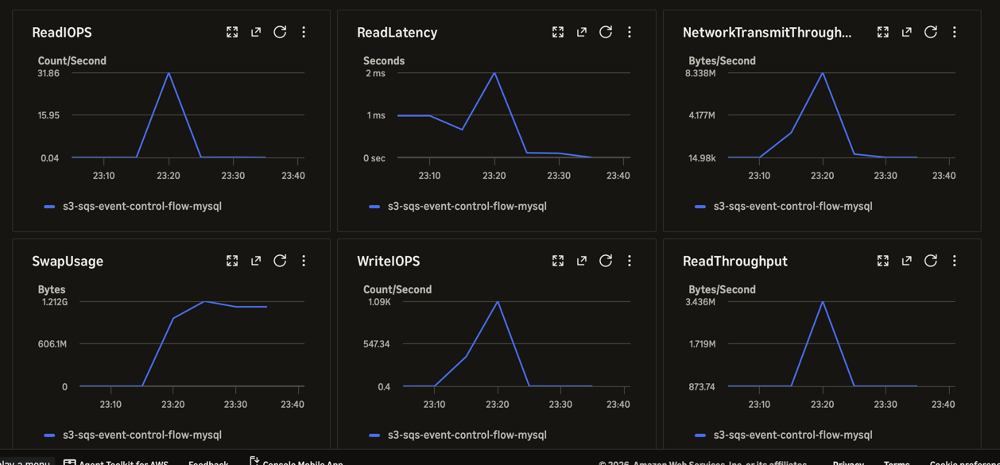
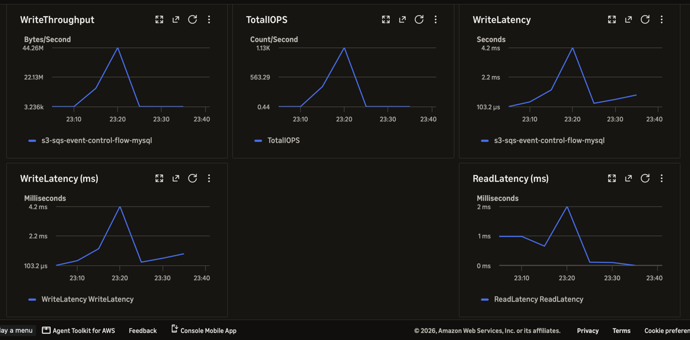

| function\_name | configured\_memory\_mb | count\(function\_name\) | min\(runtime\) | avg\(runtime\) | max\(runtime\) |
| :--- | ---: | ---: | ---: | ---: | ---: |
| s3-sqs-event-control-flow-dispatcher | 1769 | 1 | 129366 | 129366.0000 | 129366 |
| s3-sqs-event-control-flow-loader | 640 | 3001 | 538 | 9292.4618 | 42144 |
| s3-sqs-event-control-flow-processor | 640 | 30 | 36917 | 46178.0333 | 51879 |
| s3-sqs-event-control-flow-query | 1024 | 1 | 14806 | 14806.0000 | 14806 |

`configured_memory_mb` reflects current Terraform allocations, not measured peak memory or necessarily the allocation used when this run was captured.

### Total pipeline execution time (ms)

| total\_pipeline\_time\_ms |
| ---: |
| 260957 |

### SQS latency (ms)

| min\(sqs\_latency\_ms\) | avg\(sqs\_latency\_ms\) | max\(sqs\_latency\_ms\) |
| :--- | :--- | :--- |
| 226 | 19396.4009 | 5403366 |

### RDS Metrics

