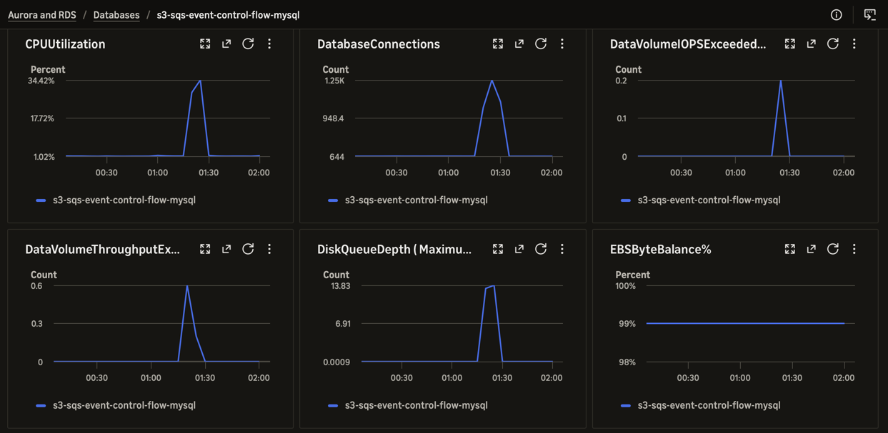
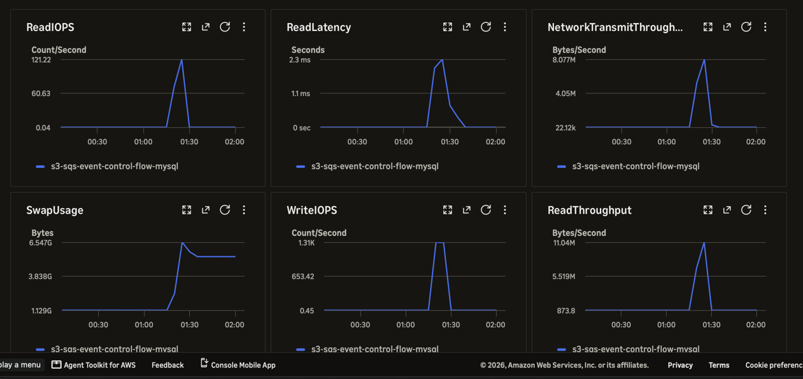
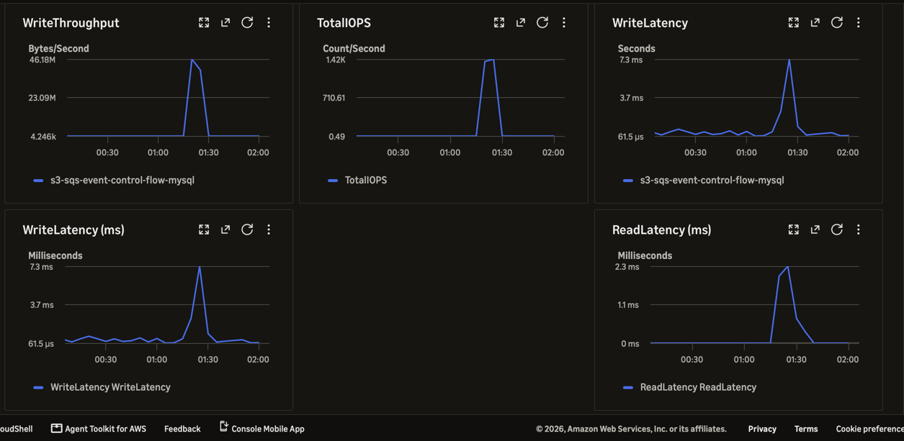

| function\_name | configured\_memory\_mb | count\(function\_name\) | min\(runtime\) | avg\(runtime\) | max\(runtime\) |
| :--- | ---: | ---: | ---: | ---: | ---: |
| s3-sqs-event-control-flow-dispatcher | 1769 | 1 | 215487 | 215487.0000 | 215487 |
| s3-sqs-event-control-flow-loader | 640 | 5000 | 582 | 27231.2614 | 226927 |
| s3-sqs-event-control-flow-processor | 640 | 50 | 42558 | 47917.0800 | 51148 |
| s3-sqs-event-control-flow-query | 1024 | 1 | 52450 | 52450.0000 | 52450 |

`configured_memory_mb` reflects current Terraform allocations, not measured peak memory or necessarily the allocation used when this run was captured.

##### Total pipeline execution time: 691732ms

### Estimated Lambda cost (USD)

Estimate uses current configured memory, SAAF average runtime, x86\_64 in us-east-2, and on-demand rates of $0.0000166667 per GB-second plus $0.20 per million requests. It excludes free tier, discounts, and non-Lambda charges such as SQS, S3, RDS, and CloudWatch Logs.

| compute cost | request cost | total Lambda cost |
| ---: | ---: | ---: |
| $1.45033312 | $0.00101040 | $1.45134352 |

### SQS latency (ms)

| min\(sqs\_latency\_ms\) | avg\(sqs\_latency\_ms\) | max\(sqs\_latency\_ms\) |
| :--- | :--- | :--- |
| 408 | 140493.4216 | 356709 |

### Database Metrics

